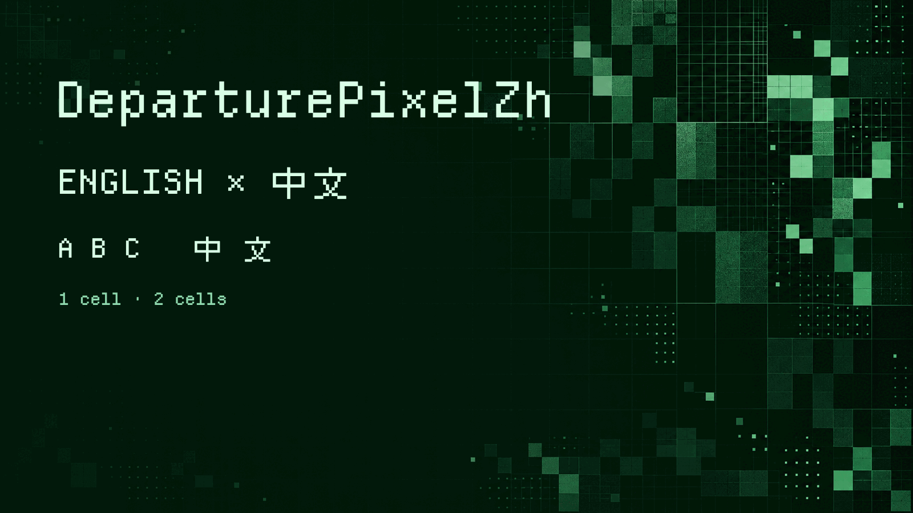

# X-DeparturePixelZhBuilder

[English](README.md) · [简体中文](README.zh-Hans.md) · [日本語](README.ja.md) · [한국어](README.ko.md) · [Español](README.es.md)

バージョン管理されたレシピからDeparturePixelZhとDeparturePixelZh Compactを生成します。英字と中国語のピクセル字形、開発者向けアイコンを一つの等幅フォントにまとめます。

これはビルダーのソースです。ビルド済みフォントは未公開で、アイコンの再配布権はフォント側の通知文書で確認中です。



## はじめに

[uv](https://docs.astral.sh/uv/)をインストールし、DeparturePixelZhのフォントリポジトリを本リポジトリと同じ親ディレクトリに置きます。リリース用ビルドでは、フォントのレシピが指定するビルダーのリビジョンを使ってください。

```sh
git clone https://github.com/codingEzio/DeparturePixelZh-OSS.git ../X-DeparturePixelZh
uv run departurepixelzh-builder build --recipe ../X-DeparturePixelZh/recipe.json --output Build
uv run departurepixelzh-builder check --recipe ../X-DeparturePixelZh/recipe.json --output Build --release
uv run -m unittest discover -s tests
```

ビルダーをローカル開発する場合は、`build`に`--development`を追加できます。リビジョンの固定を省略するため、リリース候補は生成しません。

## 処理内容

レシピは出典URLとSHA-256を固定します。ビルダーはそのURLから入力をダウンロードするか、キャッシュを再利用し、固定されたSHA-256で検証します。macOSにインストール済みのフォントをビルド入力として読み込むことはありません。ビルダーは字形を選び、共通のグリッドに合わせ、TTF、WOFF2、収録範囲、チェックサム、出典記録を生成します。英字とアイコンは1セル、全角文字は2セルです。Compactはより狭いセルを使います。絵文字はシステムの代替フォントに任せます。

字形の選択と間隔については[docs/how-it-works.md](docs/how-it-works.md)を参照してください。

## その他のコマンド

- `install`：検証済みフォントをインストールし、記録とバックアップを保存します。中断された処理は、次のインストール前に元に戻します。
- `check-installed`：インストール記録と実際のファイルを照合します。
- `sync`：利用側のマニフェストに従い、フォント、ライセンス文書、出典記録をコピーします。管理対象のファイルが外部で変更されている場合は停止します。
- `package --format desktop` は TTF、`package --format web` は WOFF2 を梱包します。既定の `all` は両形式を含みます。

引数は`uv run departurepixelzh-builder --help`または各コマンドの`--help`で確認できます。インストールと同期は、想定外の変更を検出すると停止し、明示的な復旧を求めます。

`package` はハードリンクをサポートするファイルシステムを必要とします。同名の既存アーカイブがバイト単位で同一なら再実行できます。内容が異なる場合は既存ファイルを保持して停止するため、別の出力先を指定してください。

同期中は利用側のファイルを他のプログラムで変更しないでください。中断後に通常の `sync` を実行すると復旧を試みます。競合や判断できない状態では停止するため、復旧用の記録とバックアップを保持して手動で確認してください。プロセス中断後の復旧は、電源断後の復旧を保証しません。

## 任意：元のフォントと比較する

Homebrewを導入したmacOSでは、元のフォントをインストールして見た目を比較できます。これはビルドの前提条件ではなく、DeparturePixelZhのインストールや利用にも不要です。

```sh
brew install --cask font-departure-mono font-cubic-11
```

## 範囲とライセンス

DeparturePixelZhのレシピ専用のビルダーです。汎用フォントエディターではなく、太字、斜体、カラー絵文字は追加しません。

ビルダーの独自コードは[MIT](LICENSE-MIT)です。生成フォントには別途OFLとコンポーネントのライセンス条件が適用されます。フォントの再配布時には、フォントリポジトリのライセンス文書を保持してください。

[ローカルソースの検査と保守](docs/maintenance.md).

ドキュメント用アイコン：codingEzio、[CC BY 4.0](https://creativecommons.org/licenses/by/4.0/)。 [許諾の範囲](docs/ARTWORK-LICENSE.md)。この許諾は `docs/icon.svg` のみが対象です。既存の画像、フォント、コード、第三者の素材には、それぞれの条件が引き続き適用されます。
