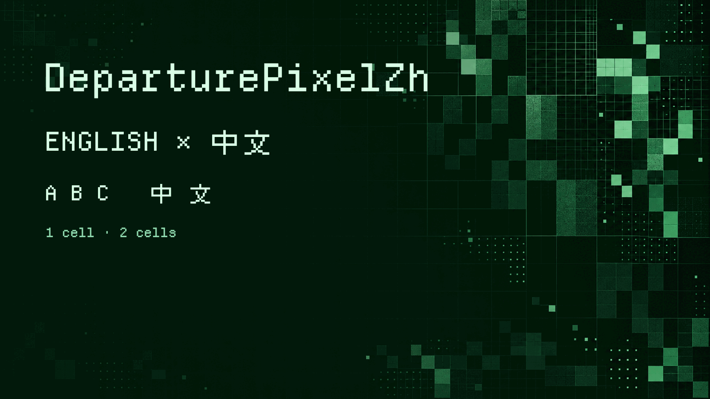

# X-DeparturePixelZhBuilder

[English](README.md) · [简体中文](README.zh-Hans.md) · [日本語](README.ja.md) · [한국어](README.ko.md) · [Español](README.es.md)

Build the DeparturePixelZh and DeparturePixelZh Compact fonts from a versioned recipe. The result combines English and Chinese pixel glyphs in one monospaced font, with developer icons.

Download the [desktop or web font packages](https://github.com/codingEzio/DeparturePixelZh-OSS/releases/tag/v0.1.1). Upstream records for some icon rights differ; see the [font notices](https://github.com/codingEzio/DeparturePixelZh-OSS/blob/main/NOTICE.md).



## Start

Install [uv](https://docs.astral.sh/uv/) and place the DeparturePixelZh font repository beside this repository. Use the builder revision pinned by the font recipe for a release build.

```sh
git clone https://github.com/codingEzio/DeparturePixelZh-OSS.git ../X-DeparturePixelZh
git checkout --detach "$(cat ../X-DeparturePixelZh/builder-version)"
uv run departurepixelzh-builder build --recipe ../X-DeparturePixelZh/recipe.json --output Build
uv run departurepixelzh-builder check --recipe ../X-DeparturePixelZh/recipe.json --output Build --release
uv run -m unittest discover -s tests
```

For local builder development, add `--development` to `build`. This bypasses the revision pin and does not create a release candidate.

## What it does

The recipe fixes source URLs and SHA-256 hashes. The builder downloads those inputs or reuses cached copies, validating them against the pinned hashes. It never reads installed macOS fonts as build inputs. The builder selects glyphs, fits them to a shared grid, and writes TTF, WOFF2, coverage maps, checksums, and source records. Latin characters and icons use one cell; full-width characters use two. Compact uses narrower cells. Emoji remain a system fallback.

[docs/how-it-works.md](docs/how-it-works.md) explains glyph selection and spacing.

## Other commands

- `install` installs verified fonts and records a receipt and backups. An interrupted installation is rolled back before the next install proceeds.
- `check-installed` checks installed files against the receipt.
- `sync` copies verified fonts, notices, and source records using a consumer manifest. It stops if managed files have changed outside the tool.
- `package --format desktop` creates a TTF archive; `package --format web` creates a WOFF2 archive. The default `all` includes both formats.

Use `uv run departurepixelzh-builder --help` or a command's `--help` for arguments. Installation and synchronization stop on unexpected changes so that recovery can be handled explicitly.

`package` needs a filesystem that supports hard links. A byte-identical archive with the same name is accepted on retry. A different existing archive is kept and the command stops; use another destination.

Do not edit consumer files with other programs during synchronization. After an interruption, a normal `sync` attempts recovery. If it reports a conflict or an ambiguous state, keep the recovery records and backups and review them manually. Recovery after process interruption does not guarantee recovery after power loss.

## Optional: compare the upstream fonts

On macOS with Homebrew, you can install the original fonts for visual comparison. This is not a build prerequisite and is not needed to install or use DeparturePixelZh.

```sh
brew install --cask font-departure-mono font-cubic-11
```

## Scope and license

This builder serves the DeparturePixelZh recipe; it is not a general font editor. It does not add bold, italic, or color emoji.

Original builder code uses [MIT](LICENSE-MIT). Generated fonts have separate OFL and component-license requirements. Keep the font repository's notices with redistributed fonts.

[Local source checks and maintenance](docs/maintenance.md).

Documentation icon: codingEzio, [CC BY 4.0](https://creativecommons.org/licenses/by/4.0/). [Scope](docs/ARTWORK-LICENSE.md). This grant covers only `docs/icon.svg`; existing artwork, fonts, code, and third-party material keep their own terms.
