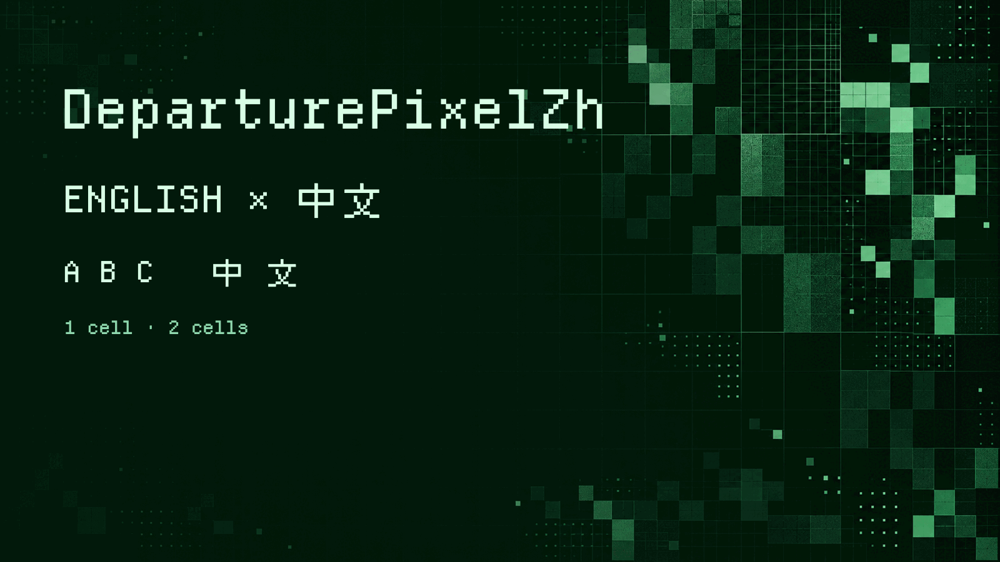

# X-DeparturePixelZhBuilder

[English](README.md) · [简体中文](README.zh-Hans.md) · [日本語](README.ja.md) · [한국어](README.ko.md) · [Español](README.es.md)

按版本化配方构建 DeparturePixelZh 和 DeparturePixelZh Compact，把英文像素字、中文像素字和开发者图标合进一款等宽字体。

这里提供构建器源码，尚未发布预构建字体；图标的再分发权利仍在字体项目的许可说明中审查。



## 开始

安装 [uv](https://docs.astral.sh/uv/)，把 DeparturePixelZh 字体仓库放在本仓库的同级目录。发布构建请使用字体配方锁定的构建器版本。

```sh
git clone https://github.com/codingEzio/DeparturePixelZh-OSS.git ../X-DeparturePixelZh
uv run departurepixelzh-builder build --recipe ../X-DeparturePixelZh/recipe.json --output Build
uv run departurepixelzh-builder check --recipe ../X-DeparturePixelZh/recipe.json --output Build --release
uv run -m unittest discover -s tests
```

本地开发构建器时，可为 `build` 添加 `--development`。它会跳过版本锁定，不生成发布候选。

## 它做什么

配方固定来源 URL 和 SHA-256。构建器从这些 URL 下载输入文件，或复用缓存，并按固定的 SHA-256 校验；不会读取 macOS 已安装字体作为构建输入。构建器选择字形、适配到共同网格，再生成 TTF、WOFF2、字符覆盖表、校验和及来源记录。英文和图标占一格，全角字符占两格；Compact 使用更窄的格子。emoji 仍使用系统备用字体。

字形选择与间距说明见 [docs/how-it-works.md](docs/how-it-works.md)。

## 其他命令

- `install`：安装验证过的字体，保存记录与备份。安装中断后，下次安装会先回滚未完成操作。
- `check-installed`：按安装记录检查已安装文件。
- `sync`：按使用方清单复制字体、许可和来源记录。受管文件在工具之外被修改时，会停止操作。
- `package --format desktop` 生成 TTF 包，`package --format web` 生成 WOFF2 包；默认 `all` 包含两种格式。

参数见 `uv run departurepixelzh-builder --help` 或各命令的 `--help`。安装和同步遇到意外修改会停止，让恢复操作得到明确处理。

`package` 需要支持硬链接的文件系统。同名压缩包的字节内容完全一致时可重试；内容不同时会保留已有文件并停止，请使用其他目标目录。

同步期间请勿用其他程序修改使用方文件。进程中断后，正常执行 `sync` 会尝试恢复。如果报告冲突或无法判断的状态，请保留恢复记录和备份，并手动检查。进程中断后的恢复不保证断电后也能恢复。

## 可选：对比原版字体

在装有 Homebrew 的 macOS 上，可以安装原版字体做视觉对比。这不是构建前提，安装或使用 DeparturePixelZh 也不需要这一步。

```sh
brew install --cask font-departure-mono font-cubic-11
```

## 范围与许可

这是 DeparturePixelZh 配方的专用构建器，不是通用字体编辑器，也不添加粗体、斜体或彩色 emoji。

构建器原创代码使用 [MIT](LICENSE-MIT)。生成字体另有 OFL 和组件许可要求；再分发字体时应保留字体仓库中的许可材料。

[本机源码检查与维护](docs/maintenance.md).

文档图标：codingEzio，[CC BY 4.0](https://creativecommons.org/licenses/by/4.0/)。 [授权范围](docs/ARTWORK-LICENSE.md)。此授权仅适用于 `docs/icon.svg`；现有图片、字体、代码及第三方材料保留各自条款。
